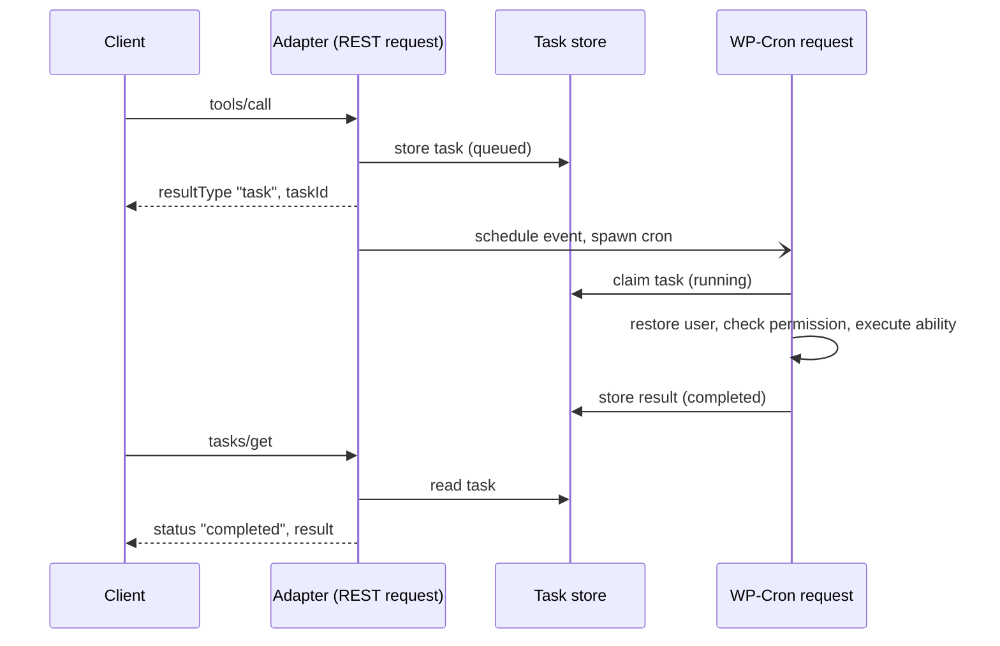

# Long-running abilities as background tasks

A tool call normally runs inside the request that carries it, so it must finish before the host's gateway timeout. The [MCP Tasks extension](https://github.com/modelcontextprotocol/ext-tasks/blob/main/specification/2026-07-28/tasks.md) (`io.modelcontextprotocol/tasks`) lets the server answer with a task handle instead. The work runs in the background and the client polls for the result.

The Adapter supports this for abilities under MCP `2026-07-28`. Task state is stored in the database and the work runs from WP-Cron.



## Opt an ability in

Set `meta.mcp.task` when you register the ability. The `execute_callback` stays an ordinary one.

```php
wp_register_ability(
    'my-plugin/rebuild-index',
    array(
        'label'               => 'Rebuild search index',
        'description'         => 'Rebuilds the search index for every post.',
        'category'            => 'my-plugin',
        'permission_callback' => static fn() => current_user_can( 'manage_options' ),
        'execute_callback'    => 'my_plugin_rebuild_index',
        'meta'                => array(
            'public' => true,
            'mcp'    => array(
                'task' => 'optional',
            ),
        ),
    )
);
```

| Value | Client declared the Tasks extension | Client did not |
| --- | --- | --- |
| not set | Runs inline | Runs inline |
| `optional` | Runs as a task | Runs inline |
| `required` | Runs as a task | Error `-32021` (Missing Required Client Capability) |

Use `required` only when the ability cannot finish inside one request. Any other value is rejected and the ability is not registered as a tool.

The setting applies whether the ability is its own tool on a custom server or is called through `mcp-adapter-execute-ability` on the default server.

## What happens to a call

1. The Adapter checks the caller's permission. A denied call gets the usual tool error and no task is created.
2. It stores the task with the tool name, arguments, server and current user, and schedules a single WP-Cron event.
3. It answers with `resultType: "task"` and a `taskId`.
4. The cron event restores the user who made the call and runs the tool call again from the start: permission check, `mcp_adapter_pre_tool_call`, execution and `mcp_adapter_tool_call_result` all run in the cron request.
5. The outcome is stored. The client reads it with `tasks/get`.

| Outcome | Task status |
| --- | --- |
| The ability returned a result | `completed`, with the tool result in `result` |
| The ability returned a `WP_Error`, or permission was denied at run time | `completed`, with `isError: true` in `result` |
| A protocol error, a fatal error or a timeout | `failed`, with a JSON-RPC error in `error` |
| `tasks/cancel` arrived before the run started | `cancelled` |

## Limits to plan for

- **A task is still one PHP request.** The cron request is not bound by the gateway timeout, but PHP's `max_execution_time` still applies unless cron runs from WP-CLI. An ability that needs longer should do its work in steps and schedule its own follow-up events.
- **A running task cannot be cancelled.** PHP cannot interrupt a callback. `tasks/cancel` is acknowledged, and the task keeps the outcome it reaches.
- **WP-Cron must run.** The Adapter spawns cron when a task is created and again each time a client polls a task that has not started, so a site without visitors still runs it. If `DISABLE_WP_CRON` is set, the task waits for the system cron job.
- **The callback runs in a cron request.** There is no REST request, and `wp_doing_cron()` is true. The current user is the user who made the call.
- **Tasks expire.** A task and its result are deleted one hour after creation, fetched or not. After that `tasks/get` reports the task as not found.
- **No input requests.** Abilities cannot ask the client for input, so a task is never `input_required`. `tasks/update` is acknowledged and ignored.

## Who can read a task

A task belongs to the user who created it, on the server and site where it was created. Any other caller gets `-32602` "Task not found", the same answer as for an ID that does not exist. Task IDs are 160 random bits.

Each `tasks/*` request must declare the extension in its client capabilities, or it gets `-32021`. Over HTTP the `Mcp-Name` header must carry the task ID.

## Filters

| Filter | Purpose |
| --- | --- |
| `mcp_adapter_task_ttl` | Seconds a task is kept, counted from creation. Default `HOUR_IN_SECONDS`, minimum one minute. Receives the tool and server. |
| `mcp_adapter_task_poll_interval` | Milliseconds a client is asked to wait between polls. Default `2000`. Receives the stored task. |
| `mcp_adapter_task_store` | The `McpTaskStoreInterface` that holds tasks. The default stores each task as a non-autoloaded option. |
| `mcp_adapter_tool_task_support` | Task support for one tool call. Receives the value, the call's arguments and the tool. A tool that executes other abilities can use it to follow the ability a call targets. |

```php
// Keep the result of a slow export for a day.
add_filter(
    'mcp_adapter_task_ttl',
    static function ( int $ttl, $tool ): int {
        return 'my-plugin-export-site' === $tool->get_name() ? DAY_IN_SECONDS : $ttl;
    },
    10,
    2
);
```

## Observability

Each background run records one `mcp.task` event with `status`, `server_id`, `tool_name` and the run's duration. The `tools/call` that created the task and each `tasks/*` request record `mcp.request` as usual.
